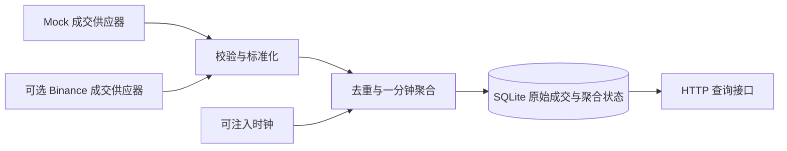

# Readable Codex transcript

Source session ID: 01a0d701-ccfb-7893-8afa-bfc9cf73d477  
Agent path: /root  
Source file: rollout-2026-09-25T13-20-28-01a0d701-ccfb-7893-8afa-bfc9cf73d477.jsonl  

This is a faithful extraction of user and assistant message text from the local Codex JSONL session. Hidden reasoning, tool arguments/results and unrelated repository/environment instruction blocks are omitted; local personal paths and credential-shaped assignments are redacted. Tool calls used in this session (name and count only): {"exec":8,"spawn_agent":2,"send_message":1}. Technical code/results are in the project and verification record. This is not a native full-fidelity export.

### 2026-09-25T05:21:00.665Z · user

[REDACTED: unrelated plugin inventory]
[REDACTED: private repository agent operating contract]
[REDACTED: local environment metadata]

### 2026-09-25T05:21:00.897Z · user

**# Quantitative Developer Take-Home Assignment**
**\*\*Timebox:\*\*** One day  
**\*\*Format:\*\*** Individual, open-book, AI-enabled
**## Background**
Quantitative strategies often use candlestick data, also called klines. Depending entirely on exchange-generated klines can introduce delays and uncertainty around recent values. An alternative is to consume a stream of executed trades and construct klines locally.
We want to understand how you approach this as an engineering problem: how you investigate unfamiliar tools, define sensible behavior, design a system, verify your work, and use AI effectively.
**## Goal**
Build a small market-data service that constructs **\*\*one-minute klines from streamed trade data\*\*** and makes the results available to downstream consumers.
You decide the architecture, implementation, interfaces, and scope. Consider how the service should behave under realistic operating conditions—not just an ideal demonstration. State your assumptions and explain the important decisions and trade-offs.
Before the assignment, we will ask whether you have VPN access. With VPN access and a reachable Binance endpoint, you may use Binance public trade data for your initial implementation. Otherwise, use a mock-data supplier.
**\*\*Regardless of whether you use live data, build a mock-data supplier\*\*** that lets you simulate normal activity and relevant edge cases. Identifying those cases and demonstrating how your system handles them are part of the assignment. Live exchange access is not a grading advantage.
**## Approach and Resources**
Use any tools and resources available to you, including AI assistants, coding agents, documentation, web searches, existing libraries, frameworks, and open-source projects. **\*\*Do not obtain help from other people.\*\*** Existing public material is allowed; asking someone else to design, implement, review, or debug your submission is not.
Reuse is encouraged. You do not need to implement everything yourself, and reinventing established functionality is not a goal. Consider established infrastructure, such as Redis, where it serves a clear purpose. No particular library or infrastructure choice is required or earns points by itself.
Identify significant reused components and their sources. You remain responsible for understanding, integrating, and verifying everything you submit, including AI-generated code.
**## How We Assess Your Work**
We assess both the submitted system and the engineering process behind it.
\| Quality | What we look for |
\| --- | --- |
\| **\*\*Functional correctness\*\*** | A useful implementation, clear assumptions, and evidence that the output and behavior can be trusted. |
\| **\*\*System design\*\*** | Sound decisions about component boundaries, concurrency, state, data flow, failures, and scaling. Complexity should have a reason. |
\| **\*\*Code quality and maintainability\*\*** | Readable, well-structured code that another engineer can understand, run, and modify. |
\| **\*\*Testing and verification\*\*** | Meaningful tests, realistic simulated conditions, and independent checks—not just a successful happy-path run. |
\| **\*\*Learning and engineering judgment\*\*** | Effective investigation of unfamiliar tools, appropriate reuse, sensible prioritization, and clear trade-offs within the timebox. |
\| **\*\*AI-native workflow\*\*** | Effective use of AI for investigation, implementation, testing, and review, with evidence that you critically evaluate its output and make your work easy to continue. |
We do not reward technology count, code volume, prompt volume, or unnecessary infrastructure. Explain what you built, why you chose that approach, what you verified, and where uncertainty remains.
**## Submission**
Submit:
1\. **\*\*A ZIP archive of your project\*\***, including the mock-data supplier, tests, instructions for running and evaluating the work, and brief notes on your design, assumptions, reused components, and known limitations.
2\. **\*\*The AI chat history for this assignment\*\***, covering the tools and sessions you used. Native exports or readable transcripts are acceptable, either inside the ZIP or as separate files. Redact credentials, secrets, and unrelated personal or confidential information while preserving the relevant technical exchanges.
**\*\*An incomplete submission is acceptable and will still be graded.\*\*** At the end of the timebox, submit what you have. Clearly distinguish what works, what has been tested, what is unfinished, and what you would do next. Do not present planned or unverified behavior as implemented functionality.

这个任务是要做什么 解释一下 以及你的思考 这是我收到的面试题 我当前的项目又有哪些可以直接复用的？如何做是最完美 机构级别的做法

### 2026-09-25T05:21:09.246Z · assistant

我先把这道题的目标和评分重点拆开，再查看你项目里现有的行情接入、K 线聚合、模拟数据和测试能力，判断哪些值得直接复用，以及怎样在一天内做出有机构工程水准、又不过度设计的提交。

### 2026-09-25T05:21:38.509Z · assistant

我会用 brainstorming 的方式梳理方案取舍，并并行核查现有代码。当前只做题目解读和复用评估；重点是区分“项目里已有行情能力”和“这些能力是否真的满足逐笔成交生成 K 线”。

### 2026-09-25T05:23:20.071Z · assistant

这道题真正难的部分已经很清楚：OHLCV 的公式很简单，难的是乱序、重复、断线之后，如何保证一根 K 线的含义仍然可信。你项目里有可参考的行情接入和完整性保护逻辑，但“接收交易所 K 线”与“从成交生成 K 线”是两个不同能力，复用时需要划清这个边界。

### 2026-09-25T05:26:15.942Z · assistant

复用边界已经核实：现有 WebSocket 接的是 Binance 的 `@kline`，成交接口则是 REST `/aggTrades`；本次源码检索没有找到可直接使用的逐笔成交聚合器。最值得带进作业的是时间语义、精度处理、重连经验和虚拟时钟测试方法。方案上，我建议把“机构级”落在明确的数据契约、可重放恢复和故障验证上，控制服务规模。

### 2026-09-25T05:28:36.623Z · assistant

这是一道**市场数据工程题**：把持续到来的成交记录，转换成下游可以信任的一分钟 K 线。面试官主要想看你如何定义正确性、处理异常、验证结果，以及在一天内做出合理取舍。

我的建议是：**提交一个小而完整、能离线复现、有明确异常处理规则的独立服务。机构级水准应体现在数据语义和故障处理上。**

我已经查看了你项目的 manifest、feature index、相关源码和测试，也核对了 Binance 官方成交推送文档。下面的复用判断基于静态检查；本次没有修改代码或运行业务测试。

先把题目翻译成一个具体例子。假设某一分钟收到以下成交，第三笔因为网络延迟最后才到：

| 成交发生时间 | 价格 | 数量 |
|---|---:|---:|
| 12:00:03 | 100 | 2 |
| 12:00:48 | 103 | 1 |
| 12:00:22 | 99 | 3 |

你应该生成：

```text
分钟：12:00:00–12:01:00
Open：100
High：103
Low：99
Close：103
Volume：6
```

这里已经隐藏了一个关键问题：**最后收到的价格是 99，但收盘价应该是 103，因为收盘价取决于成交发生顺序。**

题目明确要求交付的东西是：

- 一个从**成交数据流**构造一分钟 K 线的服务。
- 一个下游消费接口，例如 HTTP 查询、事件订阅或消息流，由你选择。
- 一个必备的 mock 数据供应器，可以模拟正常和异常情况。
- 测试、启动说明、设计取舍、复用来源和已知限制。
- 项目 ZIP，以及这次作业相关的 AI 对话记录。

真实 Binance 接入是可选项，mock 是必交项。Redis、数据库、WebSocket 输出、可视化界面都没有被强制要求。不要把自己增加的功能误认为评分必需项。

题目背后最重要的考点，是你能否回答这些问题：重复成交会不会把成交量翻倍？乱序会不会改变开收盘价？一分钟结束后还收到旧成交怎么办？断线期间的数据有没有丢？服务崩溃重启后会不会重复统计？下游能不能区分“还在变化”“已经关闭”和“数据可能不完整”？

**你当前项目能复用不少工程经验，但本次检索没有找到现成的“逐笔成交流 → 本地一分钟 K 线”核心。**

现有主链路接收的是交易所已经生成的 K 线：

```text
Binance @kline → 解码 OHLCV → 缓存 / 持久化 / Scanner
```

面试题要的是：

```text
逐笔成交 → 本地聚合 OHLCV → 下游消费者
```

具体复用边界如下：

| 现有能力 | 代码证据 | 如何用于本题 |
|---|---|---|
| Binance WebSocket 生命周期、重连、心跳 | [binanceKlineWsService.ts]([WORKSPACE]/backend/src/services/binanceKlineWsService.ts:1898) | 参考连接管理；当前订阅 `@kline`，必须新增成交适配，不能直接作为题目核心 |
| 成交数据字段映射 | [orderBookDataService.ts]([WORKSPACE]/backend/src/services/orderBookDataService.ts:165) | 已有 REST `/aggTrades`；可参考适配方法，但它不是实时供应器，也没有完整缺口分页恢复 |
| 成交模型 | [orderBook.ts]([WORKSPACE]/backend/src/types/orderBook.ts:37) | 字段概念可复用；需要重新明确时间单位、ID 类型、价格与数量精度 |
| Decimal 聚合与守恒校验 | [marketDataExactCandleGapRepairService.ts]([WORKSPACE]/backend/src/services/marketDataExactCandleGapRepairService.ts:185) | 参考精确计算方法；当前是 candles 聚合，且有固定精度约束，不能原样当作通用成交聚合器 |
| 虚拟时钟、失败重试与竞态测试 | [verify-binance-ws-disconnect-recovery.ts]([WORKSPACE]/backend/src/tools/verify-binance-ws-disconnect-recovery.ts:46) | **非常值得借用的测试方法**；需要把 candle fixture 换成可控成交事件 |
| Candle 持久化 | [scannerClosedCandlePersistenceService.ts]([WORKSPACE]/backend/src/services/scannerClosedCandlePersistenceService.ts:127) | 参考批处理、幂等键和关闭流程；现有内存缓冲不等于原始成交的崩溃恢复保证 |

另外，你已经有 `TypeScript`、`ws`、`express`、`decimal.js` 依赖。沿用这些熟悉的工具很合理。

需要特别注意两个现有差异：当前 `Candle.time` 使用秒，成交 `T` 使用毫秒；不少行情字段会转成 JavaScript `number`。抽取代码时如果不重新定义契约，很容易埋下时间和精度错误。

我不建议把整个 quant-platform 打包交上去。阅卷人应该能够在几分钟内理解项目并离线启动。适合提取的是少量独立逻辑和测试方法，同时注明来自你的既有项目。

在一天约束下，我会选择 **TypeScript 单进程服务 + Decimal + SQLite + HTTP API，默认运行 mock 模式**。SQLite 是我建议增加的恢复能力，不是题目硬性要求。



聚合核心不依赖网络和 HTTP；mock 与 Binance 进入同一个输入接口。同一交易对的状态由一个执行路径串行修改，避免多个异步回调交错更新 OHLCV。

HTTP 至少提供历史 K 线、当前形成中的 K 线、数据源状态查询。实时推送可以作为余量功能；题面并没有要求下游必须通过 WebSocket 消费。

选择 SQLite 的理由是本地部署简单、事务边界清楚，适合演示恢复。Redis Streams 在需要多个生产者、独立消费者和积压重放时才有明显价值；引入后仍然需要解决重复、确认、保留期限和恢复问题，并不会自动得到 exactly-once。

真正需要认真设计的是下面这些规则：

| 问题 | 我建议的一日版本规则 |
|---|---|
| 分钟归属 | 使用成交时间，UTC 半开区间 `[minuteStart, minuteStart + 60s)`；整点成交属于下一分钟 |
| 时间字段 | 分开保存成交时间、交易所事件时间、本地接收时间；统一内部单位 |
| 开盘与收盘 | 按成交时间排序；同一时间戳按来源明确的序列或成交 ID 决定顺序 |
| 重复成交 | 用交易所、市场、交易对、成交 ID 组成身份；同 ID 同内容忽略，同 ID 不同内容报告冲突 |
| 精度 | 价格、数量从字符串进入 Decimal，按明确的精度范围计算，API 输出十进制字符串 |
| 乱序与迟到 | 允许配置好的迟到窗口；窗口内正确更新，超过窗口的事件单独记录并暴露质量问题 |
| 空分钟 | 默认不伪造有成交的 K 线；明确区分没有成交与数据源不可用 |
| 启动与断线 | 中途启动的首分钟、断线影响的分钟标记为不完整或完整性未知 |
| 收盘语义 | “按规则关闭”和“成交完整”是两个独立状态 |
| 资源上限 | 输入队列、活动分钟、缓存和日志都有容量或保留策略；溢出不能静默丢数据 |

这里有两个特别能体现判断力的地方。

第一，**过了整点，并不意味着已经收到这一分钟的所有成交。** 如果采用 watermark，可以把它理解成“系统按约定认为旧事件已经基本到齐的时间界线”。不同交易对要分别处理，不能让活跃交易对推动另一个交易对提前收盘。还要定义无新成交时如何关闭窗口，以及拒绝异常未来时间戳，防止它推动大量窗口错误关闭。

例如迟到容忍设为两秒，这是你选择的延迟与完整性折中，不能描述成行业保证。超迟到成交如何处理，也必须在 README 和测试里一致体现。

第二，**重新连上 WebSocket，并不等于补回了断线数据。** 一天版本完全可以明确实现重连，并将未回补的缺口标记出来。只有真的实现了同源成交回补、分页、去重和衔接验证，才能声称恢复了完整数据。

如果做 Binance，我优先选择 Spot `@trade`，语义最直接。官方文档区分了 [`@trade` 原始成交和 `@aggTrade` 聚合成交](https://github.com/binance/binance-spot-api-docs/blob/master/web-socket-streams.md#trade-streams)。你现有 `/aggTrades` 的一条消息不能简单当成一笔原始成交，特别是计算 `tradeCount` 时。交易所 K 线可以用作外部对照，但不能替代本地从成交构建的主链路。

持久化方面，值得实现一个清晰的原子边界：

> 同一事务内保存已接受成交，并更新相应聚合状态；事务成功后才对消费者暴露已提交结果。

这能处理“成交已记录但 K 线没更新”或“重启重放导致成交量再加一次”等故障。还要持久化必要的关闭状态和恢复位置，不能只保存最终 OHLCV。去重保证也应说明受数据保留期限约束。

**Mock 应该是这份作业的验证工具。** 我会让它接受固定场景文件、随机种子和虚拟时钟，同时控制“成交发生时间”与“投递时间”。它需要覆盖：

- 正常多交易对成交、分钟边界、相同毫秒多笔成交。
- 重复、乱序、窗口内迟到和超迟到。
- 空分钟、启动在分钟中间、断线、重连与重复重放。
- 非法价格或数量、冲突 ID、异常未来时间。
- 突发流量、存储失败和进程中断。

其中有些由 mock supplier 生成，有些应由测试 harness 注入，例如存储提交失败。不要把所有故障都塞进供应器。

验证上，我最看重这五件事：

1. **独立结果对照。** 用一个简单的离线实现，对原始成交去重、排序、分组计算 OHLCV，与流式服务比较。它不能调用被测聚合函数，否则两者可能共享同一个错误。
2. **顺序与重复性质。** 对同一组被接纳的成交，在允许迟到的条件内打乱顺序、增加重复，结果保持一致。
3. **崩溃恢复一致性。** 在提交前后中断进程再恢复，结果与不中断运行一致；验证没有重复累计和静默丢失。
4. **真实消费者验证。** 通过 HTTP 读取结果，检查形成中、关闭、缺口、重启后的行为。
5. **有边界的压力测试。** 实测吞吐、延迟、内存和队列行为，写清硬件、输入分布与持续时间。未经测量不要声称能承受某个交易量。

交易所 K 线比较可以补充信心，但必须匹配市场、时间边界、成交范围和完整覆盖。简单的 `high >= close` 之类检查只能证明结构合理，不能证明没有漏成交。

工作日预算可以这样安排，测试从实现开始就同步写：

| 时间 | 工作 |
|---|---|
| 约 1 小时 | 定义数据契约、异常策略和示例输入输出 |
| 约 2 小时 | 完成聚合核心、mock、核心测试 |
| 约 2 小时 | 完成持久化、恢复和 HTTP 接口 |
| 约 2 小时 | 独立对照、故障测试、端到端演示 |
| 约 1 小时 | 干净环境启动检查、说明文档、AI 记录与打包 |

真实交易所接入应排在核心验证之后；时间不足就诚实提交 mock 完整版。题面明确说实时数据没有评分优势。

最终让阅卷人能够执行类似以下流程，是很好的目标——这些是建议的提交命令，目前尚未实现：

```text
npm ci
npm test
npm run demo
npm start
```

README 说明怎么运行和检查结果；设计说明解释关键取舍；复用说明记录既有项目代码和开源依赖来源；限制说明区分已验证、未实现和后续方向。AI 记录需要覆盖相关会话、关键修改和验证过程，包括参与工作的 AI 子代理记录，保留必要技术内容并脱敏；只有一篇“AI 使用总结”不够。

你这道题最有竞争力的做法，是把现有平台积累压缩成一个容易理解的作品：**输入有明确契约，聚合结果可独立复算，异常会留下可观察的后果，重启不会悄悄改变历史，而且每项能力都有对应验证。** 这比扩大技术栈更能展示机构环境需要的工程判断。

### 2026-09-25T05:31:03.532Z · user

# Files pasted by the user:

## "**这个任务本质上是：做一个“小型实时行情服务”，把一笔笔成交数据加工成一分钟 K 线，并证明它在异常情况下也有清楚、可信的行为。** 它**不是让你研究交易…": [CODEX_DATA]/attachments/6ea8869c-15b5-408c-ba9d-a0e78b46ef5a/已粘贴的文本.txt

## My request:
这是其他agent的思考 你也批判性吸收一下 然后撰写对应的设计文档以及实施计划 确保满足题目的全部要求 以及尽可能的思考完善专业的工程 拿最高分
