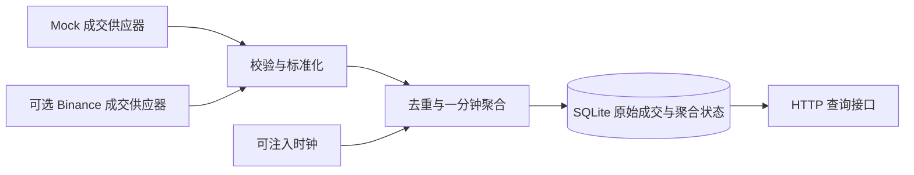

# Readable Codex transcript

Source session ID: 01a0d701-ccfb-7893-8afa-bfc9cf73d477  
Agent path: /root  
Source file: rollout-2026-09-25T13-33-12-01a0d70d-aaa3-7513-84ab-07e460e6d8b8.jsonl  

This is a faithful extraction of user and assistant message text from the local Codex JSONL session. Hidden reasoning, tool arguments/results and unrelated repository/environment instruction blocks are omitted; local personal paths and credential-shaped assignments are redacted. Tool calls used in this session (name and count only): {"exec":6,"send_message":5}. Technical code/results are in the project and verification record. This is not a native full-fidelity export.

### 2026-09-25T05:33:13.703Z · user

[REDACTED: unrelated plugin inventory]
[REDACTED: private repository agent operating contract]
[REDACTED: local environment metadata]

### 2026-09-25T05:33:13.705Z · user

**# Quantitative Developer Take-Home Assignment**
**\*\*Timebox:\*\*** One day  
**\*\*Format:\*\*** Individual, open-book, AI-enabled
**## Background**
Quantitative strategies often use candlestick data, also called klines. Depending entirely on exchange-generated klines can introduce delays and uncertainty around recent values. An alternative is to consume a stream of executed trades and construct klines locally.
We want to understand how you approach this as an engineering problem: how you investigate unfamiliar tools, define sensible behavior, design a system, verify your work, and use AI effectively.
**## Goal**
Build a small market-data service that constructs **\*\*one-minute klines from streamed trade data\*\*** and makes the results available to downstream consumers.
You decide the architecture, implementation, interfaces, and scope. Consider how the service should behave under realistic operating conditions—not just an ideal demonstration. State your assumptions and explain the important decisions and trade-offs.
Before the assignment, we will ask whether you have VPN access. With VPN access and a reachable Binance endpoint, you may use Binance public trade data for your initial implementation. Otherwise, use a mock-data supplier.
**\*\*Regardless of whether you use live data, build a mock-data supplier\*\*** that lets you simulate normal activity and relevant edge cases. Identifying those cases and demonstrating how your system handles them are part of the assignment. Live exchange access is not a grading advantage.
**## Approach and Resources**
Use any tools and resources available to you, including AI assistants, coding agents, documentation, web searches, existing libraries, frameworks, and open-source projects. **\*\*Do not obtain help from other people.\*\*** Existing public material is allowed; asking someone else to design, implement, review, or debug your submission is not.
Reuse is encouraged. You do not need to implement everything yourself, and reinventing established functionality is not a goal. Consider established infrastructure, such as Redis, where it serves a clear purpose. No particular library or infrastructure choice is required or earns points by itself.
Identify significant reused components and their sources. You remain responsible for understanding, integrating, and verifying everything you submit, including AI-generated code.
**## How We Assess Your Work**
We assess both the submitted system and the engineering process behind it.
\| Quality | What we look for |
\| --- | --- |
\| **\*\*Functional correctness\*\*** | A useful implementation, clear assumptions, and evidence that the output and behavior can be trusted. |
\| **\*\*System design\*\*** | Sound decisions about component boundaries, concurrency, state, data flow, failures, and scaling. Complexity should have a reason. |
\| **\*\*Code quality and maintainability\*\*** | Readable, well-structured code that another engineer can understand, run, and modify. |
\| **\*\*Testing and verification\*\*** | Meaningful tests, realistic simulated conditions, and independent checks—not just a successful happy-path run. |
\| **\*\*Learning and engineering judgment\*\*** | Effective investigation of unfamiliar tools, appropriate reuse, sensible prioritization, and clear trade-offs within the timebox. |
\| **\*\*AI-native workflow\*\*** | Effective use of AI for investigation, implementation, testing, and review, with evidence that you critically evaluate its output and make your work easy to continue. |
We do not reward technology count, code volume, prompt volume, or unnecessary infrastructure. Explain what you built, why you chose that approach, what you verified, and where uncertainty remains.
**## Submission**
Submit:
1\. **\*\*A ZIP archive of your project\*\***, including the mock-data supplier, tests, instructions for running and evaluating the work, and brief notes on your design, assumptions, reused components, and known limitations.
2\. **\*\*The AI chat history for this assignment\*\***, covering the tools and sessions you used. Native exports or readable transcripts are acceptable, either inside the ZIP or as separate files. Redact credentials, secrets, and unrelated personal or confidential information while preserving the relevant technical exchanges.
**\*\*An incomplete submission is acceptable and will still be graded.\*\*** At the end of the timebox, submit what you have. Clearly distinguish what works, what has been tested, what is unfinished, and what you would do next. Do not present planned or unverified behavior as implemented functionality.

这个任务是要做什么 解释一下 以及你的思考 这是我收到的面试题 我当前的项目又有哪些可以直接复用的？如何做是最完美 机构级别的做法

### 2026-09-25T05:33:13.705Z · assistant

这是一道**市场数据工程题**：把持续到来的成交记录，转换成下游可以信任的一分钟 K 线。面试官主要想看你如何定义正确性、处理异常、验证结果，以及在一天内做出合理取舍。

我的建议是：**提交一个小而完整、能离线复现、有明确异常处理规则的独立服务。机构级水准应体现在数据语义和故障处理上。**

我已经查看了你项目的 manifest、feature index、相关源码和测试，也核对了 Binance 官方成交推送文档。下面的复用判断基于静态检查；本次没有修改代码或运行业务测试。

先把题目翻译成一个具体例子。假设某一分钟收到以下成交，第三笔因为网络延迟最后才到：

| 成交发生时间 | 价格 | 数量 |
|---|---:|---:|
| 12:00:03 | 100 | 2 |
| 12:00:48 | 103 | 1 |
| 12:00:22 | 99 | 3 |

你应该生成：

```text
分钟：12:00:00–12:01:00
Open：100
High：103
Low：99
Close：103
Volume：6
```

这里已经隐藏了一个关键问题：**最后收到的价格是 99，但收盘价应该是 103，因为收盘价取决于成交发生顺序。**

题目明确要求交付的东西是：

- 一个从**成交数据流**构造一分钟 K 线的服务。
- 一个下游消费接口，例如 HTTP 查询、事件订阅或消息流，由你选择。
- 一个必备的 mock 数据供应器，可以模拟正常和异常情况。
- 测试、启动说明、设计取舍、复用来源和已知限制。
- 项目 ZIP，以及这次作业相关的 AI 对话记录。

真实 Binance 接入是可选项，mock 是必交项。Redis、数据库、WebSocket 输出、可视化界面都没有被强制要求。不要把自己增加的功能误认为评分必需项。

题目背后最重要的考点，是你能否回答这些问题：重复成交会不会把成交量翻倍？乱序会不会改变开收盘价？一分钟结束后还收到旧成交怎么办？断线期间的数据有没有丢？服务崩溃重启后会不会重复统计？下游能不能区分“还在变化”“已经关闭”和“数据可能不完整”？

**你当前项目能复用不少工程经验，但本次检索没有找到现成的“逐笔成交流 → 本地一分钟 K 线”核心。**

现有主链路接收的是交易所已经生成的 K 线：

```text
Binance @kline → 解码 OHLCV → 缓存 / 持久化 / Scanner
```

面试题要的是：

```text
逐笔成交 → 本地聚合 OHLCV → 下游消费者
```

具体复用边界如下：

| 现有能力 | 代码证据 | 如何用于本题 |
|---|---|---|
| Binance WebSocket 生命周期、重连、心跳 | [binanceKlineWsService.ts]([WORKSPACE]/backend/src/services/binanceKlineWsService.ts:1898) | 参考连接管理；当前订阅 `@kline`，必须新增成交适配，不能直接作为题目核心 |
| 成交数据字段映射 | [orderBookDataService.ts]([WORKSPACE]/backend/src/services/orderBookDataService.ts:165) | 已有 REST `/aggTrades`；可参考适配方法，但它不是实时供应器，也没有完整缺口分页恢复 |
| 成交模型 | [orderBook.ts]([WORKSPACE]/backend/src/types/orderBook.ts:37) | 字段概念可复用；需要重新明确时间单位、ID 类型、价格与数量精度 |
| Decimal 聚合与守恒校验 | [marketDataExactCandleGapRepairService.ts]([WORKSPACE]/backend/src/services/marketDataExactCandleGapRepairService.ts:185) | 参考精确计算方法；当前是 candles 聚合，且有固定精度约束，不能原样当作通用成交聚合器 |
| 虚拟时钟、失败重试与竞态测试 | [verify-binance-ws-disconnect-recovery.ts]([WORKSPACE]/backend/src/tools/verify-binance-ws-disconnect-recovery.ts:46) | **非常值得借用的测试方法**；需要把 candle fixture 换成可控成交事件 |
| Candle 持久化 | [scannerClosedCandlePersistenceService.ts]([WORKSPACE]/backend/src/services/scannerClosedCandlePersistenceService.ts:127) | 参考批处理、幂等键和关闭流程；现有内存缓冲不等于原始成交的崩溃恢复保证 |

另外，你已经有 `TypeScript`、`ws`、`express`、`decimal.js` 依赖。沿用这些熟悉的工具很合理。

需要特别注意两个现有差异：当前 `Candle.time` 使用秒，成交 `T` 使用毫秒；不少行情字段会转成 JavaScript `number`。抽取代码时如果不重新定义契约，很容易埋下时间和精度错误。

我不建议把整个 quant-platform 打包交上去。阅卷人应该能够在几分钟内理解项目并离线启动。适合提取的是少量独立逻辑和测试方法，同时注明来自你的既有项目。

在一天约束下，我会选择 **TypeScript 单进程服务 + Decimal + SQLite + HTTP API，默认运行 mock 模式**。SQLite 是我建议增加的恢复能力，不是题目硬性要求。



聚合核心不依赖网络和 HTTP；mock 与 Binance 进入同一个输入接口。同一交易对的状态由一个执行路径串行修改，避免多个异步回调交错更新 OHLCV。

HTTP 至少提供历史 K 线、当前形成中的 K 线、数据源状态查询。实时推送可以作为余量功能；题面并没有要求下游必须通过 WebSocket 消费。

选择 SQLite 的理由是本地部署简单、事务边界清楚，适合演示恢复。Redis Streams 在需要多个生产者、独立消费者和积压重放时才有明显价值；引入后仍然需要解决重复、确认、保留期限和恢复问题，并不会自动得到 exactly-once。

真正需要认真设计的是下面这些规则：

| 问题 | 我建议的一日版本规则 |
|---|---|
| 分钟归属 | 使用成交时间，UTC 半开区间 `[minuteStart, minuteStart + 60s)`；整点成交属于下一分钟 |
| 时间字段 | 分开保存成交时间、交易所事件时间、本地接收时间；统一内部单位 |
| 开盘与收盘 | 按成交时间排序；同一时间戳按来源明确的序列或成交 ID 决定顺序 |
| 重复成交 | 用交易所、市场、交易对、成交 ID 组成身份；同 ID 同内容忽略，同 ID 不同内容报告冲突 |
| 精度 | 价格、数量从字符串进入 Decimal，按明确的精度范围计算，API 输出十进制字符串 |
| 乱序与迟到 | 允许配置好的迟到窗口；窗口内正确更新，超过窗口的事件单独记录并暴露质量问题 |
| 空分钟 | 默认不伪造有成交的 K 线；明确区分没有成交与数据源不可用 |
| 启动与断线 | 中途启动的首分钟、断线影响的分钟标记为不完整或完整性未知 |
| 收盘语义 | “按规则关闭”和“成交完整”是两个独立状态 |
| 资源上限 | 输入队列、活动分钟、缓存和日志都有容量或保留策略；溢出不能静默丢数据 |

这里有两个特别能体现判断力的地方。

第一，**过了整点，并不意味着已经收到这一分钟的所有成交。** 如果采用 watermark，可以把它理解成“系统按约定认为旧事件已经基本到齐的时间界线”。不同交易对要分别处理，不能让活跃交易对推动另一个交易对提前收盘。还要定义无新成交时如何关闭窗口，以及拒绝异常未来时间戳，防止它推动大量窗口错误关闭。

例如迟到容忍设为两秒，这是你选择的延迟与完整性折中，不能描述成行业保证。超迟到成交如何处理，也必须在 README 和测试里一致体现。

第二，**重新连上 WebSocket，并不等于补回了断线数据。** 一天版本完全可以明确实现重连，并将未回补的缺口标记出来。只有真的实现了同源成交回补、分页、去重和衔接验证，才能声称恢复了完整数据。

如果做 Binance，我优先选择 Spot `@trade`，语义最直接。官方文档区分了 [`@trade` 原始成交和 `@aggTrade` 聚合成交](https://github.com/binance/binance-spot-api-docs/blob/master/web-socket-streams.md#trade-streams)。你现有 `/aggTrades` 的一条消息不能简单当成一笔原始成交，特别是计算 `tradeCount` 时。交易所 K 线可以用作外部对照，但不能替代本地从成交构建的主链路。

持久化方面，值得实现一个清晰的原子边界：

> 同一事务内保存已接受成交，并更新相应聚合状态；事务成功后才对消费者暴露已提交结果。

这能处理“成交已记录但 K 线没更新”或“重启重放导致成交量再加一次”等故障。还要持久化必要的关闭状态和恢复位置，不能只保存最终 OHLCV。去重保证也应说明受数据保留期限约束。

**Mock 应该是这份作业的验证工具。** 我会让它接受固定场景文件、随机种子和虚拟时钟，同时控制“成交发生时间”与“投递时间”。它需要覆盖：

- 正常多交易对成交、分钟边界、相同毫秒多笔成交。
- 重复、乱序、窗口内迟到和超迟到。
- 空分钟、启动在分钟中间、断线、重连与重复重放。
- 非法价格或数量、冲突 ID、异常未来时间。
- 突发流量、存储失败和进程中断。

其中有些由 mock supplier 生成，有些应由测试 harness 注入，例如存储提交失败。不要把所有故障都塞进供应器。

验证上，我最看重这五件事：

1. **独立结果对照。** 用一个简单的离线实现，对原始成交去重、排序、分组计算 OHLCV，与流式服务比较。它不能调用被测聚合函数，否则两者可能共享同一个错误。
2. **顺序与重复性质。** 对同一组被接纳的成交，在允许迟到的条件内打乱顺序、增加重复，结果保持一致。
3. **崩溃恢复一致性。** 在提交前后中断进程再恢复，结果与不中断运行一致；验证没有重复累计和静默丢失。
4. **真实消费者验证。** 通过 HTTP 读取结果，检查形成中、关闭、缺口、重启后的行为。
5. **有边界的压力测试。** 实测吞吐、延迟、内存和队列行为，写清硬件、输入分布与持续时间。未经测量不要声称能承受某个交易量。

交易所 K 线比较可以补充信心，但必须匹配市场、时间边界、成交范围和完整覆盖。简单的 `high >= close` 之类检查只能证明结构合理，不能证明没有漏成交。

工作日预算可以这样安排，测试从实现开始就同步写：

| 时间 | 工作 |
|---|---|
| 约 1 小时 | 定义数据契约、异常策略和示例输入输出 |
| 约 2 小时 | 完成聚合核心、mock、核心测试 |
| 约 2 小时 | 完成持久化、恢复和 HTTP 接口 |
| 约 2 小时 | 独立对照、故障测试、端到端演示 |
| 约 1 小时 | 干净环境启动检查、说明文档、AI 记录与打包 |

真实交易所接入应排在核心验证之后；时间不足就诚实提交 mock 完整版。题面明确说实时数据没有评分优势。

最终让阅卷人能够执行类似以下流程，是很好的目标——这些是建议的提交命令，目前尚未实现：

```text
npm ci
npm test
npm run demo
npm start
```

README 说明怎么运行和检查结果；设计说明解释关键取舍；复用说明记录既有项目代码和开源依赖来源；限制说明区分已验证、未实现和后续方向。AI 记录需要覆盖相关会话、关键修改和验证过程，包括参与工作的 AI 子代理记录，保留必要技术内容并脱敏；只有一篇“AI 使用总结”不够。

你这道题最有竞争力的做法，是把现有平台积累压缩成一个容易理解的作品：**输入有明确契约，聚合结果可独立复算，异常会留下可观察的后果，重启不会悄悄改变历史，而且每项能力都有对应验证。** 这比扩大技术栈更能展示机构环境需要的工程判断。

### 2026-09-25T05:33:13.706Z · user

# Files pasted by the user:

## "**这个任务本质上是：做一个“小型实时行情服务”，把一笔笔成交数据加工成一分钟 K 线，并证明它在异常情况下也有清楚、可信的行为。** 它**不是让你研究交易…": [CODEX_DATA]/attachments/6ea8869c-15b5-408c-ba9d-a0e78b46ef5a/已粘贴的文本.txt
## My request:
这是其他agent的思考 你也批判性吸收一下 然后撰写对应的设计文档以及实施计划 确保满足题目的全部要求 以及尽可能的思考完善专业的工程 拿最高分 有其他的建议和思考也可以和我说

### 2026-09-25T05:36:47.163Z · assistant

建议采用“单进程、有界 FIFO、统一控制事件、接收截止政策”，比全局 event-time watermark 更容易在一天内实现并证明。但要补齐以下协议，避免表面合理、细节矛盾。

**1. 明确接收、接受和封口的区别**

- `received`：数据进入进程并获得不可变的 ingress envelope。
- `enqueued`：进入有界内存 FIFO，仍可能在崩溃时丢失。
- `accepted`：校验通过，且 `trade + bar + dedupe/control state` 已经在同一 SQLite 事务提交。
- `closed`：数值按既定接收截止政策停止更新，不能推导成成交完整。

Minute 为 UTC `[minuteStart, minuteStart + 60_000)`；设 `deadline = minuteEnd + graceMs`：

```text
receivedAt < deadline   -> 可以接纳
receivedAt >= deadline  -> 超迟到
```

采用严格边界，恰好 deadline 的成交拒绝，避免 timer 与 trade 同毫秒时含糊。

**2. 统一串行事件协议**

事件为：

```text
Trade(envelope, normalizedTrade)
Timer(envelope)
SourceStatus(envelope, status)
```

Envelope 在无 `await` 的接收入口一次生成并入队：

```text
{ runId, seq, receivedAt }
```

`seq` 决定同一 run 的 FIFO 顺序，`receivedAt` 来自注入时钟。队列与 envelope 入队后不可变。

处理任何事件时，可以用该事件的 `receivedAt` 推进到期封口。由于之前已入队的 Trade 必须先处理，截止前接收到的积压不会被错误拒绝。Trade 是否迟到始终看其 envelope，不能看处理开始时的当前时间。

具体反例：

```text
deadline=12:01:02
Trade 收到并入队=12:01:01.900
处理 Trade=12:01:04
```

它仍应被接纳。若按处理时间判定，会把服务自身积压误报成上游迟到。

另一面：

```text
Timer 因调度延迟尚未执行
旧分钟 Trade 在12:01:02.100入队
```

即使 bar 目前仍为 open，也必须拒绝；不能以“timer 还没关”为接纳条件。

**Timer 合并的陷阱：不能原地更新已经入队的 Timer 时间。** 如果把位于 eligible Trade 前面的旧 Timer 改成更晚时间，会提前封口该 Trade 的窗口。只能丢弃冗余的新 Timer，或在队尾新建 Timer。定时器不依赖新成交，因此无成交、断线时也能按政策关闭已有 bar。

**3. 时钟假设须诚实**

每次运行用“启动 UTC + 单调 elapsed”提供单调 ingress 时间；mock 使用虚拟时钟。持久化最后处理的 ingress frontier，重启若 UTC 明显早于持久 frontier，应报告 `clock_regression` 并停止接纳，不能悄悄把旧记录重新打开。

这仍依赖宿主机 UTC 在声明误差内正确，不是解决了所有时钟漂移。异常未来成交必须拒绝，不能让成交时间推动全局封口。不要使用不同交易对共享的最大成交时间 watermark。

**4. 判定顺序是协议的一部分**

推荐：

```text
输入结构/范围校验
→ 标准化与身份查找
→ 已存在同内容：duplicate，不改数值
→ 已存在不同内容：conflict，不覆盖原成交
→ 新身份：按 receivedAt 检查截止
→ 计算下一状态
→ 原子提交
→ 发布已提交状态
```

已接受成交在封口后重放，应只记录 duplicate，不能同时作为 late-rejected 标记缺失，否则普通重连会错误污染历史质量。

价格与数量内容比较应在规范化后进行，使 `"1"` 与 `"1.0"` 等价。相同成交时间的排序规则必须由适配器声明；若用数字 ID，不能用字符串字典序，也不能把超安全整数转成 JavaScript `number`。

**5. SQLite 事务不能被描述为无损接入**

同事务保存 accepted trade、bar、身份索引、源状态/封口进度，事务成功后才更新对外可见内存；事务失败不能留下已经改变的 OHLCV 内存对象。可采用计算下一状态副本，commit 后替换。

提供的保证是：

> 已提交前缀一致；已提交成交重放不会重复累计。

不能宣称：

> 只要网络收到过，崩溃后就不会丢；任意崩溃恢复结果都等于不停机。

FIFO 中尚未提交的数据会丢。重启应保守记录从最后持久化处理 frontier 到本次恢复的 `recovery_gap`。后续重放仍遵守截止政策。

崩溃一致性测试分两类：

- 已提交后、消费者观察前崩溃：重放不能重复累计，读取恢复相同已提交结果。
- 提交前崩溃：事务全部回滚；若 mock 能在截止前重放，则恢复结果可与不中断相同；若截止后才重放，应验证 late 和质量降级，不强求相同 OHLCV。

若未来要求“截止前到达即使尚未处理也在崩溃后保留资格”，必须增加持久 ingress journal 或有确认/重放协议的上游。这是额外能力，不能靠同事务聚合暗示已经实现。

**6. 封口数值与数据质量分开版本化**

建议：

```text
state: open | closed
coverage: unverified | known_incomplete | verified_mock
qualityReasons: [...]
valueRevision
qualityRevision
```

`verified_mock` 只能由完整 fixture 的独立核验支持；连接健康不能变成 `complete`。断线可能没有成交，所以它通常意味着 `unverified + source_gap`，不等于已证明漏了成交。明确拒绝或丢掉一笔合法新成交才支持 `known_incomplete`。

bar 封口后，数值不变，但晚到成交、身份冲突、新发现缺口可能增加质量原因。因此“整个 final record 永久不变”不成立，只能说其 OHLCV 停止修订。

重要反例：`grace=2s`，在 `12:01:01` 断线。虽然 `12:00` 分钟已结束，该分钟还在等待宽限期内成交，仍可能受影响。缺口不能只标到断线时间所属分钟。

质量投影应按“源不可用区间”与该 minute 可能接受成交的时间范围重叠判断，保守包括尚未到 deadline 的上一分钟。如果允许未来时间容差，开始边界还需要考虑该容差。

没有成交默认不生成 bar，但必须提供持久化覆盖区间/源状态接口，否则消费者无法区分“不存在 bar 因为空闲”和“不存在 bar 因为数据不可用”。

**7. 有界队列必须有可见失败行为**

Mock 可以等待背压；真实 WebSocket 回调不能被描述成上游肯定会等待。

队列满时：

- 停止继续接纳该源。
- 使用预留控制槽或单个不会丢失的 fault latch 记录 overflow。
- 保留并处理之前已入队事件。
- 持久化 source gap，readiness 降级。
- 不静默丢弃最旧成交、覆盖队列、无限重试或无限加大队列。

如果 fault 控制事件也走已满队列，故障记录本身会丢失。控制通道的内存上限和 fault 保存方式也需明确。

**8. 建议列为验收门槛的具体反例**

1. 截止前入队、截止后处理仍接纳。
2. 截止后到达、Timer 未处理仍拒绝。
3. deadline 前 1ms 接纳，恰好 deadline 拒绝。
4. 已接受成交在 deadline 后重放只计 duplicate。
5. 同身份不同内容不覆盖，并标明 conflict。
6. 无后续成交时 timer 仍能封口。
7. 已入队 timer 不因合并越过后续 eligible trade。
8. 12:01:01 的断线影响仍在 grace 的 12:00 bar。
9. 事务 rollback 后内存、SQLite、HTTP 一致。
10. commit 后进程中断，重放不重复累计。
11. 未提交队列丢失后标 recovery gap，不能声称无损恢复。
12. 没有 bar 的断流区间仍可查询到质量问题。
13. 一个交易对的未来异常消息不关闭另一个交易对。
14. overflow 的质量记录本身不会因队列满而丢失。
15. 时间回拨与重启不会使已关闭窗口重新打开。

附件思路总体正确；上述内容是值得吸收后补齐的关键工程约束。无需为一天作业实现 Kafka、修订历史、自动补数或复杂 watermark。把这些行为写成可执行场景，并让 HTTP 结果与独立 oracle、恢复测试一致，收益最高。

### 2026-09-25T05:51:41.890Z · assistant

发现 5 处建议在实施前修正的契约问题；没有发现需要推翻整体架构的问题。

1. **正常重启的停机观察缺口没有闭合。**  
   设计第 **258 行**只为非正常退出写 `recovery_gap`，但第 **369 行**的正常 shutdown 同样停止接收；cleanStop 到下次真正 connected 之间仍可能漏成交。例如 12:01:01 正常停机，12:01:03 重启，上一分钟仍处宽限期时的成交可能遗漏。建议持久化 `sourceStoppedAt`；正常停机记录 `source_gap`，异常停机从最后持久 frontier 记录 `recovery_gap`；缺口都延续到新 source connected，不止于进程 restartTime。计划第 **201、205 行**同步增加该测试。

2. **EOF/stopped 无法经过已定义的唯一写入接口。**  
   设计第 **132 行**的 source 事件只允许 connected/disconnected，但第 **222、276、305 行**及计划第 **169 行**要求 source stopped；计划第 **87 行**唯一 coordinator 方法只有 `handle(InputEvent)`。补充 `source: stopped` 或 `source_stopped` 控制事件及原因，并明确：EOF 不人为跳过 grace、不强制 final；想展示 closed 的 fixture 必须显式 advance 到 deadline。这样持久状态、readiness 和 mock 生命周期才走同一入口。

3. **clock_untrusted 的事件处理与通用封口规则冲突。**  
   设计第 **174 行**要求按本事件的 receivedAt 推进关闭，第 **194 行**又要求 clock_untrusted 停止自动封口。若 fault 也按通用“先推进再判事件”处理，它仍会关闭窗口。应明确：已在 fault 前排队的可信前缀可依原 envelope 完成；clock_untrusted 本身不推进封口，并将后续输入/封口冻结。增加“发现时钟异常恰逢 deadline”的测试，避免实现者自行选择顺序。

4. **配置身份遗漏会改变历史接纳/质量含义的 futureTolerance。**  
   设计第 **250 行**列出的身份绑定项缺少 `futureToleranceMs`，但第 **196、228 行**用它决定输入资格和质量投影。同一 DB 以 5s 后改为 0s 重启，会在不改变历史 quality events 的情况下改变哪些 bars 受影响。将全部语义配置纳入规范配置哈希，至少包括 `futureToleranceMs`、时间/排序政策版本和 clockDriftLimit；测试只改 futureTolerance 也拒绝重用 DB。计划第 **198 行**同步覆盖。

5. **乱序不变性的前提目前过宽，会生成错误测试结论。**  
   设计第 **324 行**说所有事件都在截止前便满足不变性，但同身份冲突采用先接受者胜出；容量上限也使顺序改变接纳集合；“提前超过 futureTolerance”和稍后合法投递也都可能早于 deadline。应限定为：同一组无冲突 canonical identities，每次投递均通过全部输入条件、均在允许时间范围内、无容量/故障丢弃。Oracle 只能把**已接纳**身份加入去重账本，不能让一次 future-invalid 投递占住身份。计划第 **226、229 行**增加“过早拒绝、稍后合法同 ID 应接纳”反例。

可选补强：

- 设计第 **230 行**明确未有相关质量事件时 `qualityRevision=0`；开放 gap 关闭或修改时更新 commit sequence，避免质量内容变了版本没变。
- 计划第 **202 行**说明同步 `Store.transaction` 中的 beforeCommit IPC 屏障如何等待；不要误用 async callback，使 COMMIT 在父进程收到屏障前发生。可使用仅测试同步阻塞机制和有限超时。
- 计划第 **116 行**的“SQLite 不可用则 P0 退路”不够具体：`:memory:` 同样依赖 node:sqlite，不能解决模块不可用。可改为运行时前置依赖未满足则先修环境；只有“文件恢复未验证”才降级到同 adapter 的 `:memory:`。

### 2026-09-25T06:10:52.202Z · assistant

新增意见里最值得补入的 5 项如下，均可放入已有切片，无需新增架构。

1. **数量缩放性质测试**  
   加到设计独立验证段、计划 S4：
   > 在两个独立空存储中运行同一合格场景，将第二组每笔数量及其所有重复副本统一乘以正整数 2。变换不越过数值/资源边界时，OHLC、tradeCount 不变，volume 与 quoteVolume 精确翻倍。预期使用 BigInt 定点计算，不用生产 reducer 生成。  
   
   必须使用独立存储；在同库复用相同 ID、改变数量，会正确触发 conflict，不能拿来做这项测试。

2. **合法极端价格必须保留**  
   加到设计第 144 行附近、T15/T16：
   > 校验只执行声明的格式、范围和时间合同；不因相对上一笔涨跌过大而删除成交。`100 → 10000 → 101` 在全部输入条件合格时必须产生 high=10000。市场异常检测不属于本题接纳规则。  
   
   这可防止实现者擅自加入“清洗异常值”，破坏真实高低点。

3. **提供一个小型消费者示例**  
   纳入 S2 现有 demo 或新增极薄 `examples/read-klines.mjs`：
   > 只用 Node fetch 读取 HTTP，展示 open/closed、OHLCV、completeness、qualityReasons，并单独查询无 bar 时的 coverage。示例不得将 closed 或无质量原因解释成完整市场数据；显示各响应的 asOfCommitSeq，不假装多个请求共享快照。  
   
   最后 ZIP 验证调用这个示例，比增加前端更直接满足下游可用性。

4. **明确聚合执行活性与成交静默的区别**  
   补设计第 365 行及 `/readyz`：
   > 分开报告最后源活动、最后成交事件时间、最后 coordinator 成功处理时间、待处理队列最老年龄。聚合循环抛错立即将 readiness 置为 degraded；队列有积压却持续无处理进度才属于执行停滞。没有成交且队列为空不构成故障，EOF stopped 也不等于意外死亡。  
   
   不新增监控服务或自动重启。说明同一事件循环彻底阻塞时，本进程 HTTP 也可能无法作答，不能宣称自监控覆盖这种故障。

5. **mutation 必须证明行为断言有效**  
   修改设计第 361 行、计划第 234 行：
   > 每个 mutation 应仍可解析、类型检查并启动；只把与目标行为直接相关的断言失败记为有效捕获，记录测试名和 expected/actual。语法错误、依赖失败或启动失败不算测试发现了语义错误。恢复正确源码后重新运行完整目标测试。  
   
   不引入 mutation 框架，保留现有几个定点修改即可。

此外还有两处新的时间契约歧义，建议顺手补清：

- **虚拟 mock 不参与真实墙钟漂移比较。** 设计第 194 行的“每次运行持续比较 wall time 与逻辑时钟”应限定为 real clock 模式；否则黄金场景固定在 2026-01-01，会立即因真实日期不同触发 fault。虚拟模式用场景时间判断接纳/封口，实际耗时另用进程单调时钟测量。
- **固定场景的背压不能暗改投递时间。** 明确 virtual runner 在 `backpressured` 时先 drain、保持虚拟时间不变，再重试同一 action；只有成功入队才前进到下一 action。若真实 pacing 导致实际接收时间变化，应记录实际 ingress trace，并承认它与固定虚拟场景的接纳结果可能不同，不能直接用原定 atMs 当独立 oracle 的实际接收时间。
