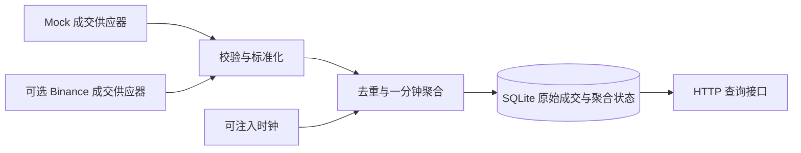

# Readable Codex transcript

Source session ID: 01a0d701-ccfb-7893-8afa-bfc9cf73d477  
Agent path: /root  
Source file: rollout-2026-09-25T13-33-30-01a0d70d-f0b0-7e73-be3e-4a753daaf194.jsonl  

This is a faithful extraction of user and assistant message text from the local Codex JSONL session. Hidden reasoning, tool arguments/results and unrelated repository/environment instruction blocks are omitted; local personal paths and credential-shaped assignments are redacted. Tool calls used in this session (name and count only): {"exec":4,"send_message":4}. Technical code/results are in the project and verification record. This is not a native full-fidelity export.

### 2026-09-25T05:33:31.149Z · user

[REDACTED: unrelated plugin inventory]
[REDACTED: private repository agent operating contract]
[REDACTED: local environment metadata]

### 2026-09-25T05:33:31.150Z · user

**# Quantitative Developer Take-Home Assignment**
**\*\*Timebox:\*\*** One day  
**\*\*Format:\*\*** Individual, open-book, AI-enabled
**## Background**
Quantitative strategies often use candlestick data, also called klines. Depending entirely on exchange-generated klines can introduce delays and uncertainty around recent values. An alternative is to consume a stream of executed trades and construct klines locally.
We want to understand how you approach this as an engineering problem: how you investigate unfamiliar tools, define sensible behavior, design a system, verify your work, and use AI effectively.
**## Goal**
Build a small market-data service that constructs **\*\*one-minute klines from streamed trade data\*\*** and makes the results available to downstream consumers.
You decide the architecture, implementation, interfaces, and scope. Consider how the service should behave under realistic operating conditions—not just an ideal demonstration. State your assumptions and explain the important decisions and trade-offs.
Before the assignment, we will ask whether you have VPN access. With VPN access and a reachable Binance endpoint, you may use Binance public trade data for your initial implementation. Otherwise, use a mock-data supplier.
**\*\*Regardless of whether you use live data, build a mock-data supplier\*\*** that lets you simulate normal activity and relevant edge cases. Identifying those cases and demonstrating how your system handles them are part of the assignment. Live exchange access is not a grading advantage.
**## Approach and Resources**
Use any tools and resources available to you, including AI assistants, coding agents, documentation, web searches, existing libraries, frameworks, and open-source projects. **\*\*Do not obtain help from other people.\*\*** Existing public material is allowed; asking someone else to design, implement, review, or debug your submission is not.
Reuse is encouraged. You do not need to implement everything yourself, and reinventing established functionality is not a goal. Consider established infrastructure, such as Redis, where it serves a clear purpose. No particular library or infrastructure choice is required or earns points by itself.
Identify significant reused components and their sources. You remain responsible for understanding, integrating, and verifying everything you submit, including AI-generated code.
**## How We Assess Your Work**
We assess both the submitted system and the engineering process behind it.
\| Quality | What we look for |
\| --- | --- |
\| **\*\*Functional correctness\*\*** | A useful implementation, clear assumptions, and evidence that the output and behavior can be trusted. |
\| **\*\*System design\*\*** | Sound decisions about component boundaries, concurrency, state, data flow, failures, and scaling. Complexity should have a reason. |
\| **\*\*Code quality and maintainability\*\*** | Readable, well-structured code that another engineer can understand, run, and modify. |
\| **\*\*Testing and verification\*\*** | Meaningful tests, realistic simulated conditions, and independent checks—not just a successful happy-path run. |
\| **\*\*Learning and engineering judgment\*\*** | Effective investigation of unfamiliar tools, appropriate reuse, sensible prioritization, and clear trade-offs within the timebox. |
\| **\*\*AI-native workflow\*\*** | Effective use of AI for investigation, implementation, testing, and review, with evidence that you critically evaluate its output and make your work easy to continue. |
We do not reward technology count, code volume, prompt volume, or unnecessary infrastructure. Explain what you built, why you chose that approach, what you verified, and where uncertainty remains.
**## Submission**
Submit:
1\. **\*\*A ZIP archive of your project\*\***, including the mock-data supplier, tests, instructions for running and evaluating the work, and brief notes on your design, assumptions, reused components, and known limitations.
2\. **\*\*The AI chat history for this assignment\*\***, covering the tools and sessions you used. Native exports or readable transcripts are acceptable, either inside the ZIP or as separate files. Redact credentials, secrets, and unrelated personal or confidential information while preserving the relevant technical exchanges.
**\*\*An incomplete submission is acceptable and will still be graded.\*\*** At the end of the timebox, submit what you have. Clearly distinguish what works, what has been tested, what is unfinished, and what you would do next. Do not present planned or unverified behavior as implemented functionality.

这个任务是要做什么 解释一下 以及你的思考 这是我收到的面试题 我当前的项目又有哪些可以直接复用的？如何做是最完美 机构级别的做法

### 2026-09-25T05:33:31.150Z · assistant

这是一道**市场数据工程题**：把持续到来的成交记录，转换成下游可以信任的一分钟 K 线。面试官主要想看你如何定义正确性、处理异常、验证结果，以及在一天内做出合理取舍。

我的建议是：**提交一个小而完整、能离线复现、有明确异常处理规则的独立服务。机构级水准应体现在数据语义和故障处理上。**

我已经查看了你项目的 manifest、feature index、相关源码和测试，也核对了 Binance 官方成交推送文档。下面的复用判断基于静态检查；本次没有修改代码或运行业务测试。

先把题目翻译成一个具体例子。假设某一分钟收到以下成交，第三笔因为网络延迟最后才到：

| 成交发生时间 | 价格 | 数量 |
|---|---:|---:|
| 12:00:03 | 100 | 2 |
| 12:00:48 | 103 | 1 |
| 12:00:22 | 99 | 3 |

你应该生成：

```text
分钟：12:00:00–12:01:00
Open：100
High：103
Low：99
Close：103
Volume：6
```

这里已经隐藏了一个关键问题：**最后收到的价格是 99，但收盘价应该是 103，因为收盘价取决于成交发生顺序。**

题目明确要求交付的东西是：

- 一个从**成交数据流**构造一分钟 K 线的服务。
- 一个下游消费接口，例如 HTTP 查询、事件订阅或消息流，由你选择。
- 一个必备的 mock 数据供应器，可以模拟正常和异常情况。
- 测试、启动说明、设计取舍、复用来源和已知限制。
- 项目 ZIP，以及这次作业相关的 AI 对话记录。

真实 Binance 接入是可选项，mock 是必交项。Redis、数据库、WebSocket 输出、可视化界面都没有被强制要求。不要把自己增加的功能误认为评分必需项。

题目背后最重要的考点，是你能否回答这些问题：重复成交会不会把成交量翻倍？乱序会不会改变开收盘价？一分钟结束后还收到旧成交怎么办？断线期间的数据有没有丢？服务崩溃重启后会不会重复统计？下游能不能区分“还在变化”“已经关闭”和“数据可能不完整”？

**你当前项目能复用不少工程经验，但本次检索没有找到现成的“逐笔成交流 → 本地一分钟 K 线”核心。**

现有主链路接收的是交易所已经生成的 K 线：

```text
Binance @kline → 解码 OHLCV → 缓存 / 持久化 / Scanner
```

面试题要的是：

```text
逐笔成交 → 本地聚合 OHLCV → 下游消费者
```

具体复用边界如下：

| 现有能力 | 代码证据 | 如何用于本题 |
|---|---|---|
| Binance WebSocket 生命周期、重连、心跳 | [binanceKlineWsService.ts]([WORKSPACE]/backend/src/services/binanceKlineWsService.ts:1898) | 参考连接管理；当前订阅 `@kline`，必须新增成交适配，不能直接作为题目核心 |
| 成交数据字段映射 | [orderBookDataService.ts]([WORKSPACE]/backend/src/services/orderBookDataService.ts:165) | 已有 REST `/aggTrades`；可参考适配方法，但它不是实时供应器，也没有完整缺口分页恢复 |
| 成交模型 | [orderBook.ts]([WORKSPACE]/backend/src/types/orderBook.ts:37) | 字段概念可复用；需要重新明确时间单位、ID 类型、价格与数量精度 |
| Decimal 聚合与守恒校验 | [marketDataExactCandleGapRepairService.ts]([WORKSPACE]/backend/src/services/marketDataExactCandleGapRepairService.ts:185) | 参考精确计算方法；当前是 candles 聚合，且有固定精度约束，不能原样当作通用成交聚合器 |
| 虚拟时钟、失败重试与竞态测试 | [verify-binance-ws-disconnect-recovery.ts]([WORKSPACE]/backend/src/tools/verify-binance-ws-disconnect-recovery.ts:46) | **非常值得借用的测试方法**；需要把 candle fixture 换成可控成交事件 |
| Candle 持久化 | [scannerClosedCandlePersistenceService.ts]([WORKSPACE]/backend/src/services/scannerClosedCandlePersistenceService.ts:127) | 参考批处理、幂等键和关闭流程；现有内存缓冲不等于原始成交的崩溃恢复保证 |

另外，你已经有 `TypeScript`、`ws`、`express`、`decimal.js` 依赖。沿用这些熟悉的工具很合理。

需要特别注意两个现有差异：当前 `Candle.time` 使用秒，成交 `T` 使用毫秒；不少行情字段会转成 JavaScript `number`。抽取代码时如果不重新定义契约，很容易埋下时间和精度错误。

我不建议把整个 quant-platform 打包交上去。阅卷人应该能够在几分钟内理解项目并离线启动。适合提取的是少量独立逻辑和测试方法，同时注明来自你的既有项目。

在一天约束下，我会选择 **TypeScript 单进程服务 + Decimal + SQLite + HTTP API，默认运行 mock 模式**。SQLite 是我建议增加的恢复能力，不是题目硬性要求。



聚合核心不依赖网络和 HTTP；mock 与 Binance 进入同一个输入接口。同一交易对的状态由一个执行路径串行修改，避免多个异步回调交错更新 OHLCV。

HTTP 至少提供历史 K 线、当前形成中的 K 线、数据源状态查询。实时推送可以作为余量功能；题面并没有要求下游必须通过 WebSocket 消费。

选择 SQLite 的理由是本地部署简单、事务边界清楚，适合演示恢复。Redis Streams 在需要多个生产者、独立消费者和积压重放时才有明显价值；引入后仍然需要解决重复、确认、保留期限和恢复问题，并不会自动得到 exactly-once。

真正需要认真设计的是下面这些规则：

| 问题 | 我建议的一日版本规则 |
|---|---|
| 分钟归属 | 使用成交时间，UTC 半开区间 `[minuteStart, minuteStart + 60s)`；整点成交属于下一分钟 |
| 时间字段 | 分开保存成交时间、交易所事件时间、本地接收时间；统一内部单位 |
| 开盘与收盘 | 按成交时间排序；同一时间戳按来源明确的序列或成交 ID 决定顺序 |
| 重复成交 | 用交易所、市场、交易对、成交 ID 组成身份；同 ID 同内容忽略，同 ID 不同内容报告冲突 |
| 精度 | 价格、数量从字符串进入 Decimal，按明确的精度范围计算，API 输出十进制字符串 |
| 乱序与迟到 | 允许配置好的迟到窗口；窗口内正确更新，超过窗口的事件单独记录并暴露质量问题 |
| 空分钟 | 默认不伪造有成交的 K 线；明确区分没有成交与数据源不可用 |
| 启动与断线 | 中途启动的首分钟、断线影响的分钟标记为不完整或完整性未知 |
| 收盘语义 | “按规则关闭”和“成交完整”是两个独立状态 |
| 资源上限 | 输入队列、活动分钟、缓存和日志都有容量或保留策略；溢出不能静默丢数据 |

这里有两个特别能体现判断力的地方。

第一，**过了整点，并不意味着已经收到这一分钟的所有成交。** 如果采用 watermark，可以把它理解成“系统按约定认为旧事件已经基本到齐的时间界线”。不同交易对要分别处理，不能让活跃交易对推动另一个交易对提前收盘。还要定义无新成交时如何关闭窗口，以及拒绝异常未来时间戳，防止它推动大量窗口错误关闭。

例如迟到容忍设为两秒，这是你选择的延迟与完整性折中，不能描述成行业保证。超迟到成交如何处理，也必须在 README 和测试里一致体现。

第二，**重新连上 WebSocket，并不等于补回了断线数据。** 一天版本完全可以明确实现重连，并将未回补的缺口标记出来。只有真的实现了同源成交回补、分页、去重和衔接验证，才能声称恢复了完整数据。

如果做 Binance，我优先选择 Spot `@trade`，语义最直接。官方文档区分了 [`@trade` 原始成交和 `@aggTrade` 聚合成交](https://github.com/binance/binance-spot-api-docs/blob/master/web-socket-streams.md#trade-streams)。你现有 `/aggTrades` 的一条消息不能简单当成一笔原始成交，特别是计算 `tradeCount` 时。交易所 K 线可以用作外部对照，但不能替代本地从成交构建的主链路。

持久化方面，值得实现一个清晰的原子边界：

> 同一事务内保存已接受成交，并更新相应聚合状态；事务成功后才对消费者暴露已提交结果。

这能处理“成交已记录但 K 线没更新”或“重启重放导致成交量再加一次”等故障。还要持久化必要的关闭状态和恢复位置，不能只保存最终 OHLCV。去重保证也应说明受数据保留期限约束。

**Mock 应该是这份作业的验证工具。** 我会让它接受固定场景文件、随机种子和虚拟时钟，同时控制“成交发生时间”与“投递时间”。它需要覆盖：

- 正常多交易对成交、分钟边界、相同毫秒多笔成交。
- 重复、乱序、窗口内迟到和超迟到。
- 空分钟、启动在分钟中间、断线、重连与重复重放。
- 非法价格或数量、冲突 ID、异常未来时间。
- 突发流量、存储失败和进程中断。

其中有些由 mock supplier 生成，有些应由测试 harness 注入，例如存储提交失败。不要把所有故障都塞进供应器。

验证上，我最看重这五件事：

1. **独立结果对照。** 用一个简单的离线实现，对原始成交去重、排序、分组计算 OHLCV，与流式服务比较。它不能调用被测聚合函数，否则两者可能共享同一个错误。
2. **顺序与重复性质。** 对同一组被接纳的成交，在允许迟到的条件内打乱顺序、增加重复，结果保持一致。
3. **崩溃恢复一致性。** 在提交前后中断进程再恢复，结果与不中断运行一致；验证没有重复累计和静默丢失。
4. **真实消费者验证。** 通过 HTTP 读取结果，检查形成中、关闭、缺口、重启后的行为。
5. **有边界的压力测试。** 实测吞吐、延迟、内存和队列行为，写清硬件、输入分布与持续时间。未经测量不要声称能承受某个交易量。

交易所 K 线比较可以补充信心，但必须匹配市场、时间边界、成交范围和完整覆盖。简单的 `high >= close` 之类检查只能证明结构合理，不能证明没有漏成交。

工作日预算可以这样安排，测试从实现开始就同步写：

| 时间 | 工作 |
|---|---|
| 约 1 小时 | 定义数据契约、异常策略和示例输入输出 |
| 约 2 小时 | 完成聚合核心、mock、核心测试 |
| 约 2 小时 | 完成持久化、恢复和 HTTP 接口 |
| 约 2 小时 | 独立对照、故障测试、端到端演示 |
| 约 1 小时 | 干净环境启动检查、说明文档、AI 记录与打包 |

真实交易所接入应排在核心验证之后；时间不足就诚实提交 mock 完整版。题面明确说实时数据没有评分优势。

最终让阅卷人能够执行类似以下流程，是很好的目标——这些是建议的提交命令，目前尚未实现：

```text
npm ci
npm test
npm run demo
npm start
```

README 说明怎么运行和检查结果；设计说明解释关键取舍；复用说明记录既有项目代码和开源依赖来源；限制说明区分已验证、未实现和后续方向。AI 记录需要覆盖相关会话、关键修改和验证过程，包括参与工作的 AI 子代理记录，保留必要技术内容并脱敏；只有一篇“AI 使用总结”不够。

你这道题最有竞争力的做法，是把现有平台积累压缩成一个容易理解的作品：**输入有明确契约，聚合结果可独立复算，异常会留下可观察的后果，重启不会悄悄改变历史，而且每项能力都有对应验证。** 这比扩大技术栈更能展示机构环境需要的工程判断。

### 2026-09-25T05:33:31.150Z · user

# Files pasted by the user:

## "**这个任务本质上是：做一个“小型实时行情服务”，把一笔笔成交数据加工成一分钟 K 线，并证明它在异常情况下也有清楚、可信的行为。** 它**不是让你研究交易…": [CODEX_DATA]/attachments/6ea8869c-15b5-408c-ba9d-a0e78b46ef5a/已粘贴的文本.txt
## My request:
这是其他agent的思考 你也批判性吸收一下 然后撰写对应的设计文档以及实施计划 确保满足题目的全部要求 以及尽可能的思考完善专业的工程 拿最高分 有其他的建议和思考也可以和我说

### 2026-09-25T05:35:16.424Z · assistant

可直接纳入设计文档的建议如下。已只读核对原题和粘贴材料，没有修改文件或访问业务服务。

**对其他 agent 意见的取舍**

吸收：事件时间分桶、确定性首末成交、来源作用域内去重、受限迟到、封口与完整性分离、虚拟时钟、独立 oracle、消费者端验收、诚实说明恢复边界。

补强：

- “连接健康”不能证明“成交完整”。质量应允许 `unknown`，只有 mock 明确提供完整覆盖等有依据的情形才能宣称 `complete`。
- 冻结 OHLCV 后，后来发现缺口仍应允许质量状态降级；不要让 `final` 同时冻结了错误的完整性声明。
- HTTP 查询足以满足“使下游可用”；实时输出订阅没有硬性必要。
- SQLite 建议作为高质量目标；题面没有要求持久化。内存版是明确声明限制的降级方案，不能称为崩溃安全版。
- 不应把许多复杂功能都标为“一日必做”，导致 mock、正确性、README 和聊天记录反而没有完成。
- “最高分”无法保证。能优化的是评分证据覆盖、核心功能完成度和解释的一致性。

**要求追踪矩阵**

| ID | 题目要求 | 具体可演示结果 | 验证方式 | 提交物 |
|---|---|---|---|---|
| R01 | 从流式成交构建 1m K 线 | mock 逐条投递；HTTP 返回对应 OHLCV | 明确预期 fixture；跨分钟端到端 | 服务源码、demo、预期 JSON |
| R02 | 必须有 mock supplier | 固定场景、种子、独立成交与投递时间、可控时钟 | 同配置重复运行结果相同 | mock 源码、场景文件、使用说明 |
| R03 | 考虑现实运行 | 重复、乱序、迟到、断流、非法消息、空闲、过载有声明行为 | 场景矩阵，每行关联实际测试 | 测试、行为契约 |
| R04 | 下游可消费 | HTTP 查询当前及已关闭窗口，返回质量状态 | 从外部接口验收、参数错误验证 | API 说明、调用示例 |
| R05 | 假设和重要取舍 | 时间、排序、精度、封口、完整性、恢复边界明确 | 测试与接口逐项核对契约 | DESIGN.md、LIMITATIONS.md |
| R06 | 可信输出与独立检查 | 流式结果等于独立离线计算 | 独立 oracle；手算黄金样例；受限排列性质 | oracle 测试、样例 |
| R07 | 个人、开卷、AI 可用；禁止其他人帮助 | 记录本人判断与 AI 辅助过程 | 自述来源和参与方式；不要求找同事审查 | AI 使用说明 |
| R08 | 复用与来源 | 库及既有项目抽取逻辑有来源、版本和修改说明 | 依赖清单、许可证、抽取来源核对 | REUSE.md、lockfile、必要许可证 |
| R09 | 可运行可评估的 ZIP | 解压后按 README 安装、测试、演示成功 | 从 ZIP 解压到独立临时目录，按文档执行 | 最终 ZIP、README、验证记录 |
| R10 | 完整 AI 历史，允许脱敏 | 本作业相关所有工具/会话/AI 子代理记录可读 | 文件可打开，记录范围清楚，脱敏保留技术内容 | ai-history/、INDEX.md |
| R11 | 一日时间盒，未完成可提交 | 清楚区分已验证、已实现未验证、未实现 | 发布前逐项状态核对 | STATUS.md 或 README 状态表 |

建议每项实际测试、命令和文件路径最终替换进矩阵；设计阶段只写“计划”，不提前填“通过”。

**评分维度到证据**

| 评分维度 | 最有说服力的证据 |
|---|---|
| 功能正确性 | 手算样例＋独立 oracle＋重复/乱序/边界反例 |
| 系统设计 | 单一状态所有者、明确事务边界、受限队列、错误传播、质量状态 |
| 可维护性 | source/core/storage/api/test 边界清楚，核心无网络依赖，锁定依赖 |
| 测试验证 | 虚拟时间、种子重放、真实 HTTP 端到端、SQLite 模式的进程崩溃测试 |
| 学习和判断 | 来源引用、淘汰 Redis/实时推送等方案的具体理由、诚实取舍记录 |
| AI 工作方式 | 真实发现问题→提出反例→修正→回归测试的过程；本人能解释每个决定 |

不要为展示 AI 使用而制造错误或伪造“审查发现”。

**一日优先级与截止门**

建议按约 8 小时有效开发规划，实际开始/截止时间另行记录；题目中的一天不应被解释成无休止连续开发。

- **0–0.75h：** 冻结契约、范围、黄金样例、依赖版本；从现在保存聊天记录。
- **0.75–3h：** mock、聚合器、虚拟时钟、去重/乱序/迟到/精度测试。此阶段完成可独立验证核心。
- **3–4h：** HTTP API、质量状态、端到端 demo，形成可以提交的最小服务。
- **4–5.5h：** SQLite 事务、恢复、真实进程中断测试；这是首选高质量目标。
- **5.5–6.5h：** 独立 oracle 扩展、过载/错误路径、受限基准。
- **6.5–8h：** 文档、复用来源、AI 记录、ZIP、独立目录安装运行与检查。

优先级建议：

- P0：mock、正确聚合、接口、关键异常语义、独立检查、README、完整记录、ZIP。
- P1：SQLite 恢复、真实崩溃测试、受限性能观察。
- P2：Binance live、实时订阅、历史补数、容器。
- 本次不做：分布式协调、跨机高可用、Redis 集群、UI、完整行情平台。

达到打包预留时间即停止增加功能。SQLite 未通过真实恢复验证时，报告其状态为“已实现未验证”或回到明确支持的内存模式；禁止保留“crash-safe”宣传。如果 API 从存储查询，必须用事务成功后的持久化事实作为输出，不能只因为写入排队就返回成功数据。

**SQLite 高质量目标与内存降级**

| 项目 | SQLite 高质量目标 | 内存降级 |
|---|---|---|
| 适用性 | 演示确定事务和重放边界，体现工程判断 | 完成题面必要闭环，降低实现风险 |
| 必须验证 | 成交身份、聚合及必要状态原子更新；重放幂等；中断恢复 | 容量限制；重启显式丢失状态；首分钟部分覆盖 |
| 可声明保证 | 仅对已成功提交且处于声明保留范围的输入 | 仅在单次进程运行期间 |
| 不能声明 | 网络端零丢失、所有硬件故障可恢复、端到端 exactly-once | 持久化、无损恢复、跨重启去重 |

SQLite 的 WAL、`synchronous` 设置和事务并非自动提供无限强持久性。对进程崩溃、操作系统/电源故障、磁盘故障应分别声明范围。

**提交与复用容易失分的细节**

- ZIP 顶层只有一个项目目录；包含 lockfile、必要 fixtures、许可证、运行说明。排除 `.env`、凭证、真实业务数据库、原量化项目私有数据、`node_modules`、无关聊天。
- “无需 Binance/VPN 即可评估”不等于“干净机器完全无需网络”。如果 `npm ci` 需要 registry，应明确安装时网络需求；测试和 demo 则无需外部行情。
- 固定已验证的 Node 版本，说明 Windows/Linux 验证范围；SQLite 原生依赖要优先检查该版本的安装可行性。
- 既有项目复用要记录原始路径、版本/commit（若可获得）、来源权利、抽取内容和修改。未知归属代码不能仅标“我的项目”就认为可公开提交。
- 聊天记录应包含本轮其他 agent 的相关技术交流；用户贴来的意见也属于被使用的输入。原始导出优先，易读脱敏副本可并存。
- AI 使用说明不能替代聊天历史。若某工具无法导出，明确缺失范围和原因，不把事后摘要冒充原始记录。
- 文档中“命令将提供”和“命令已运行成功”必须区分；基准数值必须由实际测量填入并带环境。
- 最值钱的演示可控制在几分钟：乱序和重复不改正确结果；迟到边界行为明确；断流降级质量；重启后已提交结果一致。这个演示直接贯穿大部分评分项。

### 2026-09-25T05:50:59.333Z · assistant

整体覆盖原题全部必交项，复用披露、AI 全会话记录、ZIP 解压验收和“计划≠通过”的边界都写得很好。SQLite 保证也没有夸成端到端无损。建议修正以下 5 点：

1. **时间预算算错。**  
   [计划:36]([WORKSPACE]/docs/superpowers/plans/2026-09-25-trade-to-kline-take-home.md:36) 声称约 8 小时，但 40–46 行合计 **580 分钟，即 9 小时 40 分钟**。  
   最小修改：按真实作业窗口改称约 10 小时，或保留 8 小时并实际压缩/删除 P1 预算；必须保留 S5 硬截止。

2. **SQLite 不可用时的退路无法执行。**  
   [计划:116]([WORKSPACE]/docs/superpowers/plans/2026-09-25-trade-to-kline-take-home.md:116) 要求 SQLite 不可用时走 P0，但 [设计:76]([WORKSPACE]/docs/superpowers/specs/2026-09-25-trade-to-kline-take-home-design.md:76) 的 P0 仍是同一个 `node:sqlite` 的 `:memory:`。  
   最小修改：明确 **`:memory:` 只解决文件恢复未完成，不能解决 SQLite API 不可用**。运行时不可用先切换到声明支持的 Node；仍无法解决则诚实标为安装阻塞/未完成，不再称有现成 P0 退路。

3. **可选恢复排在必需独立验证之前，优先级不自洽。**  
   [计划:192]([WORKSPACE]/docs/superpowers/plans/2026-09-25-trade-to-kline-take-home.md:192) 开始可选 S3，而原题必需的 independent checks 到 [计划:226]([WORKSPACE]/docs/superpowers/plans/2026-09-25-trade-to-kline-take-home.md:226) 才实现；S3 超时会挤掉 P0。  
   最小修改：把黄金样例＋最小独立 oracle 移到 S1/S2，S2 出口包含 R06；或者先完成 S4 正确性部分再进入 S3。验收矩阵增加 `P0/P1` 列，P0 退路不能强制要求未实现的文件恢复测试通过。

4. **正常退出再启动也存在数据观察缺口。**  
   [设计:258]([WORKSPACE]/docs/superpowers/specs/2026-09-25-trade-to-kline-take-home-design.md:258) 只对非正常退出添加 `recovery_gap`，会漏掉正常停机期间的源缺口。例如 12:00:59 优雅退出、12:01:03 重启，12:00 bar 宽限期有真实观察中断。  
   最小修改：任何停机后重新打开旧 DB，都记录停机/最后已处理时间至重启的观察缺口；cleanStop 只决定是否还需保守推断未提交损失。T22 补正常退出跨截止重启。

5. **commit 前 IPC 屏障与同步事务接口不兼容，需要指定可执行办法。**  
   [计划:85]([WORKSPACE]/docs/superpowers/plans/2026-09-25-trade-to-kline-take-home.md:85) 的事务回调是同步接口，但 [计划:202]([WORKSPACE]/docs/superpowers/plans/2026-09-25-trade-to-kline-take-home.md:202) 要在 beforeCommit 发 IPC 并等待父进程。直接 `await` 不在同步事务模型内，阻塞 event loop 等 IPC 又无法消费消息。  
   最小修改：用仅测试专用子进程脚本显式 `BEGIN → 写入 → 发出 IPC → 挂起等待被 kill`，不进入正常 COMMIT；恢复后验证回滚。afterCommit 使用正常事务返回后 IPC。避免为测试改变生产 Store 的同步契约。

### 2026-09-25T06:10:17.133Z · assistant

已完整核对权威原题 [docs/quant_developer_take_home_assignment.md]([WORKSPACE]/docs/quant_developer_take_home_assignment.md)。现有 R01–R11 已覆盖核心必交，没有发现需要扩大功能范围的遗漏。预算确为 480 分钟，我撤回上轮错误意见。

最终稿建议补强以下 5 点：

1. **明确权威文档与范围优先级。**  
   当前 [计划:11]([WORKSPACE]/docs/superpowers/plans/2026-09-25-trade-to-kline-take-home.md:11) 只说矛盾时以设计为准。增加原题链接，并声明“原题及用户明确决定 → 设计契约 → 实施计划”；P0 中部分工程选择是本方案承诺，并非面试方逐项强制要求。不要改名原题或创建带反斜线下划线的副本。

2. **最终状态表缺少逐项具体下一步。**  
   原题 [第 52 行]([WORKSPACE]/docs/quant_developer_take_home_assignment.md:52) 明确要求解释 “what you would do next”。现有 [计划:259]([WORKSPACE]/docs/superpowers/plans/2026-09-25-trade-to-kline-take-home.md:259) 有状态分类，但建议每个未完成项增加 `nextAction`、优先级和决定性验证。不要只有“未来可增加 Redis/live”的泛化列表。

3. **Goal 必须区分按要求完成与截止时提交未完成版本。**  
   建议 prompt 原文加入：  
   > 以记录的绝对截止时间为硬边界，既有调查和规划时间计入；不得因重启、压缩上下文或新工具重新起算。距截止 100 分钟进入提交阶段。P0 及最终归档验证通过即可完成本方案；P1/P2 不作为无限继续的理由。截止到达时交付当前成果与明确未完成项，不把“已打包”表述为“全部工程要求已完成”。  
   不应使用“持续执行直到最完美/拿到最高分”为停止条件。

4. **AI 历史需要明确最后收口方式。**  
   原题 [第 50 行]([WORKSPACE]/docs/quant_developer_take_home_assignment.md:50) 允许单独附件。现有 [计划:253]([WORKSPACE]/docs/superpowers/plans/2026-09-25-trade-to-kline-take-home.md:253) 要求完整记录，但没有处理最后验包产生的新对话。建议先冻结并验证项目 ZIP，再把后续相关 transcript 作为独立附件交付，INDEX 记录会话、覆盖截止点及脱敏。避免为包含“最后一次打包对话”无限重打包。无法取得的真实记录保持缺失状态，不以摘要冒充完整历史。

5. **最终清单应检查实际文件和结果，不只检查复选框。**  
   [设计:404]([WORKSPACE]/docs/superpowers/specs/2026-09-25-trade-to-kline-take-home-design.md:404) 的门槛方向正确；Goal 再明确：每项完成必须关联实际文件、执行命令及结果，未跑测试保持 `not_run`，不是通过；已通过的检查无新变更不反复重跑；发现同一外部阻塞时保存进度、报告具体缺口，不无限探测或新增功能绕开。

最终交付清单建议固定为：

- 项目 ZIP：源码、mock 与场景、tests/oracle、依赖锁和运行时版本。
- 简明 README：安装、启动、测试、demo、查询示例及实际验证平台。
- DESIGN / LIMITATIONS / REUSE：假设、语义、取舍、真实限制和复用来源。
- 实测结果：R01–R11、T01–T30 状态；P1/P2 允许明确未做。
- AI 历史及 INDEX：全部相关会话、子代理技术交流、来源与脱敏说明；AI_USAGE 不能替代历史。
- 最终状态与下一步：已验证、已实现未验证、未实现，具体后续行动。
- ZIP 解压后的实际运行证据和文件链接；无密钥、业务数据、无关聊天或父仓库依赖。

本轮若只是撰写 Goal Prompt，不应因此开始实现或创建执行目标；未来真正执行时再按该 prompt 的明确授权和仓库治理启动。
